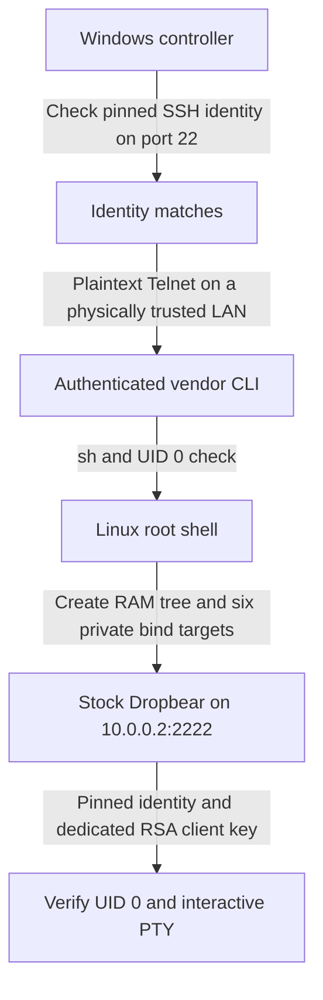

# D-Link DSL-G2562DG Root Access & Temporary SSH

[](LICENSE)

**Investigation date:** 19 October 2026.

Device-specific research and a Windows controller for key-authenticated root SSH on a stock **D-Link DSL-G2562DG**, without flashing custom firmware. Verified on one device running `TK_1.00TK_V1.2.12ak_20221018`; other builds and hardware revisions are unverified.

The result is an interactive `uid=0(admin)` Linux shell and a second, temporary Dropbear SSH service on `10.0.0.2:2222`. It uses the router's existing binary and a RAM-backed chroot. The Windows controller can recreate that service, check its health, and remove resources it owns.

**Start here:** [research explanation](docs/RESEARCH.md) · [reproduction walkthrough](docs/REPRODUCING.md) · [installation and operation](automation/README.md) · [security model](docs/SECURITY.md).

## What the investigation established

| Finding | Evidence and practical value |
| --- | --- |
| A firmware-derived management account reaches Linux UID 0 | Telnet login reaches `AMS#`; `sh` opens the Linux shell. The management login is `root`, while Unix UID 0 is named `admin`. [Access proof](findings/ROOT_ACCESS_VERIFIED.md). |
| Vendor Dropbear has distinct password behavior and a specific root-key path | This build looks for `/etc/dropbear/authorized_keys` for UID 0. The existing root filesystem is read-only, so a separate filesystem view supplies that path. [Binary analysis](docs/DROPBEAR_ANALYSIS.md). |
| Stock Dropbear supports key-authenticated root SSH in a RAM chroot | Six private bind targets expose existing programs, libraries, runtime files, and PTYs. Independent SSH checks establish UID 0 and a working interactive terminal. [Mechanism](docs/RESEARCH.md#3-working-around-the-read-only-filesystem). |
| Temporary service restoration and scoped rollback worked | Recorded trials cover restore, repeated restore, rollback, and another round trip after a router restart and explicit host-trust update. [Live results](findings/LIVE_TEST_RESULTS.md). |
| The firmware extraction is reproducible | Recovered offline extraction code reproduced 17,405 nodes and 3,627 artifacts, all byte-identical to the retained originals. [Extraction instructions and validation](research/firmware/README.md). |

These are observations from one owner-authorized investigation. This repository does not establish a new CVE, cross-device credential reuse, or completed vendor notification. Firmware and literal management passwords are excluded.

## How it works



The chroot supplies an alternate filesystem view; it is **not a security sandbox**. The daemon disables password authentication and local/remote forwarding. The controller checks deployment ownership, mounts, listener state, supported ingress policy, and SSH behavior before reporting success.

## Requirements and limits

- **Device and network:** the tested firmware, router `10.0.0.2/24`, bridge `br0`, and a physically trusted wired LAN. These assumptions are enforced; changing only the TOML does not port the tool to another network.
- **Existing access:** an authorized Telnet management credential and an independently verified router SSH host fingerprint. The controller does not discover credentials. For offline firmware research, see the [digest-locked extractor](research/firmware/README.md); keep extracted data private.
- **Controller:** Windows 11, Python 3.12+, Git Bash in its default installation directory, and a dedicated passphrase-protected RSA key of at least 3072 bits. PowerShell 7 is needed for the scheduler-definition test.
- **Reboots:** the RAM service disappears at reboot. A running, signed-in Windows controller can restore it while the pinned identity still matches. Observed host-key rotation required independent verification and an explicit trust update; unattended recovery across rotation is not implemented.
- **Router changes:** provisioning intentionally writes temporary RAM files and adds mounts/processes. It does not deliberately modify firmware, bootloader, startup scripts, flash partitions, or firewall rules. A reboot removes this temporary deployment; it does not factory-reset the router or certify that ordinary vendor logging made no persistent writes.

## Install and reproduce

First follow the [walkthrough](docs/REPRODUCING.md) to establish the original root shell, check compatibility, and independently verify the router's public host identity. Keep the original management/recovery path available.

From the repository root, install the controller in its own environment:

```powershell
cd automation
py -3.12 -m venv .venv
.\.venv\Scripts\python.exe -m pip install -e '.[test]'
.\.venv\Scripts\dlink-ssh.exe --help
```

Follow [key preparation and local setup](automation/README.md#prepare-a-protected-client-key) to create and protect your client key, store secrets in Windows Credential Manager, and run `setup`. Setup is local; it does not connect to the router. Then use the same environment:

```powershell
.\.venv\Scripts\dlink-ssh.exe status
.\.venv\Scripts\dlink-ssh.exe restore
.\.venv\Scripts\dlink-ssh.exe status
.\.venv\Scripts\dlink-ssh.exe rollback
```

`restore` intentionally changes router RAM state; `rollback` removes only resources whose ownership and safety can be verified. Review [command effects and cleanup](automation/README.md#manual-commands-and-effects) first. Unknown ownership or unsafe state can cause cleanup to refuse.

For an interactive connection, use the [verified SSH invocation](docs/REPRODUCING.md#open-an-interactive-terminal), including its dedicated known-hosts file and scoped legacy-algorithm exceptions. A modern client's default `ssh` command may reject this old Dropbear build. Optional monitoring and Windows Task Scheduler setup are documented in the [operating guide](automation/README.md#monitor-and-task-scheduler); installing the package alone does not enable them.

## Security and publication

Use only equipment you own or are authorized to administer. Telnet sends credentials and shell traffic in plaintext. Checking the SSH identity first **does not cryptographically authenticate the separate Telnet connection**. Use an isolated, physically trusted wired connection and do not expose management ports to the Internet.

This legacy SSH service requires scoped SHA-1-era compatibility settings. The tool checks its supported logical ingress policy; it does not prove end-to-end WAN isolation or modernize the firmware. Read the [security and recovery guidance](docs/SECURITY.md) before deployment.

Historical evidence is sanitized and explicitly separated from operating instructions. Firmware images, extracted binaries, router backups, installed credentials, and private keys are excluded. See [sanitization notes](docs/PUBLICATION.md) for exclusions and how to interpret the redacted evidence. The MIT license covers the distributed project material; vendor firmware is not distributed or relicensed here.

## Repository guide

| Directory | Contents |
| --- | --- |
| [`automation/`](automation/README.md) | Maintained Python CLI, offline tests, and Windows Task Scheduler scripts |
| [`scripts/`](scripts/) | Reference setup, rollback, and diagnostic shell scripts |
| [`docs/`](docs/README.md) | Research explanation, reproduction, operation, security, and historical technical reports |
| [`findings/`](findings/README.md) | Curated capability proofs and recorded live-test results |
| [`research/firmware/`](research/firmware/README.md) | Offline extractor, firmware provenance, structural metadata, and validation record |
| [`research/controllers/`](research/controllers/README.md) | Historical experiment source preserved as non-executable reference text |
| [`archive/`](archive/README.md) | Chronological reports and sanitized raw evidence |
| [`tests/`](tests/) | Offline safety, diagnostics, and firmware-extractor tests |

For early hypotheses and superseded conclusions, follow the [reading guide](docs/READING_GUIDE.md). For a claim-by-claim audit, see [README evidence](docs/README_CLAIMS.md).

## Offline verification

From the repository root:

```powershell
python -m unittest discover -s tests -v
cd automation
.\.venv\Scripts\python.exe -m pytest -q
```

These suites cover safety boundaries, extraction fixtures, controller behavior, local SSH integration, and scheduler definitions where the required tools are available. The real-router integration test is skipped unless explicitly opted into. Offline tests do not reproduce the historical live trials; those have separate [recorded evidence](findings/LIVE_TEST_RESULTS.md).

## License

[MIT](LICENSE).
